<h1 align="center">Hi 👋, I'm Pasindu Ransika</h1>

<p align="center">
  
</p>

<p align="center">
  <strong>☕ Java · Spring Boot · REST APIs · MySQL</strong>
</p>

<p align="center">
  
  
  
</p>

## 👨‍💻 About Me

```text
pasindu@backend:~$ curl -i localhost:8080/api/v1/profile
HTTP/1.1 200 OK
Content-Type: application/json

{
  "name": "Pasindu Ransika",
  "focus": "Java backend development",
  "building": ["NatureFLOW", "GymBuddy"],
  "openTo": "Software engineering internships"
}
```

- 🎓 Studying Software Engineering at **The Open University of Sri Lanka**
- 🔐 Learning how to secure APIs with **Spring Security and JWT**
- 🧪 Practicing API testing with **JUnit and Postman**
- ⚡ Outside of coding, I’m a WWE fan. Acknowledge the Tribal Chief! ☝️

## 🤝 Connect With Me

<p align="center">
  <a href="https://www.linkedin.com/in/pasinduransika">
    
  </a>
  <a href="mailto:v.pasinduransika@gmail.com">
    
  </a>
  <a href="https://github.com/PasinduRansika?tab=repositories">
    
  </a>
</p>

## 📦 Dependencies

| Area | Stack |
| :--- | :--- |
| **Backend & database** |  |
| **Frontend** |  |
| **Other languages & runtimes** |  |
| **Tools & CI** |  |

## 🌟 Featured Projects

<table>
  <tr>
    <td width="50%" valign="top">
      <h3>🌱 NatureFLOW</h3>
      <p><strong>Plantation Management System</strong></p>
      <p>A team project for managing plants, plots, plantings, and plantation records.</p>
      <p>My backend work includes REST APIs, authentication, database integration with JPA/Hibernate, and API testing.</p>
      <p><code>Java</code> <code>Spring Boot</code> <code>MySQL</code> <code>Docker</code></p>
      <p><sub>🔒 Private team repository</sub></p>
    </td>
    <td width="50%" valign="top">
      <h3>🏋️ GymBuddy</h3>
      <p><strong>Gym Management Demo</strong></p>
      <p>A Java OOP project that models gym memberships, simulated payments, and class bookings.</p>
      <p><code>Java</code> <code>OOP</code></p>
      <p><sub>✅ Demo complete</sub></p>
    </td>
  </tr>
</table>

## 🎯 Currently Learning

| Area | What I’m practicing |
| :--- | :--- |
| **Java** | Collections, Streams, and exception handling |
| **Spring Boot** | Structuring REST APIs with controllers, services, and repositories |
| **Security** | Authentication and authorization with Spring Security and JWT |
| **Databases** | SQL and persistence with MySQL and JPA/Hibernate |
| **Testing** | Unit tests, integration tests, and API checks |
| **DevOps** | Docker and GitHub Actions |

## 📊 GitHub Analytics

<p align="center">
  
  
</p>

<p align="center">
  <a href="https://github.com/PasinduRansika?tab=overview">
    
  </a>
</p>

<p align="center">
  <a href="https://github.com/PasinduRansika?tab=overview">Contribution history</a>
  ·
  <a href="https://github.com/PasinduRansika?tab=achievements">Achievements</a>
</p>

---

<div align="center">

> I believe the best way to become a better developer is to keep learning, practice what I learn, and build things along the way.

<br/>

### ☕ Keep Learning. Keep Building.

Thanks for visiting my profile! 👋

Feel free to check out my repositories or connect with me.

</div>
